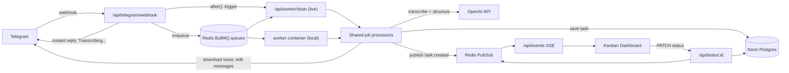

# TaskBot: Telegram voice and text to tasks

Send a Telegram bot a text or voice message and it becomes a structured task: title, description, priority and due date, extracted by OpenAI. You can also change existing tasks in plain language ("put task 5 in progress", "make the dentist one high priority and move it to Friday"). The bot always shows what it's planning to do and acts only after you press **Confirm**. Every task gets a short number (`#01`, `#02`, ...). Tasks show up instantly on a live Kanban dashboard, and their status can be changed from either the dashboard or inline buttons in Telegram.

**Live demo:** `https://<your-project>.vercel.app` · **Bot:** `@<your_bot_username>` _(fill in after deploying)_

## Stack

| Layer            | Tech                                                                         |
| ---------------- | ---------------------------------------------------------------------------- |
| Bot interface    | Telegram Bot API (webhook, inline keyboards)                                 |
| Speech-to-text   | OpenAI `gpt-4o-mini-transcribe` (configurable, e.g. `whisper-1`)             |
| Intent + fields  | OpenAI `gpt-4.1-mini` with strict JSON-schema structured outputs             |
| Web + API        | Next.js 16 (App Router, route handlers, SSE), React 19, Tailwind 4, dnd-kit  |
| Database         | PostgreSQL on Neon, Prisma 7 (driver adapter `@prisma/adapter-pg`)           |
| Queue / realtime | Redis: BullMQ job queues + Pub/Sub                                           |
| Runtime          | Docker Compose locally; Vercel + Neon + Upstash for the free live deployment |

## Architecture



### Flow of a voice message

1. Telegram POSTs the update to `/api/telegram/webhook`. The route checks the `X-Telegram-Bot-Api-Secret-Token` header, deduplicates on `update_id` (`SET tg:update:<id> NX EX 3600`) and upserts the user.
2. The bot **immediately** replies "Transcribing your voice message..." and enqueues a `transcription` job (`jobId = voice-<update_id>`). The webhook answers in ~5–25 ms.
3. The worker downloads the `.oga` file, transcribes it, and **edits the same message** to show the transcript. It then enqueues `task-processing`.
4. `task-processing` sends GPT the message, the user's 50 most recent tasks and, if the user replied to a message (e.g. a task card), that message's text. GPT returns one plan: **create** a task (`title, description, priority, dueDate`, with relative dates resolved in `APP_TIMEZONE`), **update** one of the user's tasks (status, priority, title, description or due date, by number or by name), or **clarify** (ambiguous task, unsupported request). The plan is validated against the user's tasks, so unknown task numbers and no-op changes become a clarifying question. **Nothing is written to the database yet.** The plan is stored in Redis as a pending action and a `notifications` job is queued.
5. `notifications` edits the status message into the proposal, e.g. "Update task #05 · Call dentist: Status: Pending → In Progress", with **Confirm / Cancel** buttons.
6. **Confirm** (handled in the webhook) creates or updates the task, publishes `task.created` / `task.updated` on Redis Pub/Sub, and turns the proposal into the task card with **Start / Done / Reopen** buttons and an **Open dashboard** link. **Cancel** leaves everything unchanged. Only the person who sent the message can press either button, and proposals expire after 24 hours.
7. Every open dashboard receives the event over SSE, and the card appears with a highlight and a toast.

Text messages skip step 3. Status changes from the dashboard are published the same way and queued as a `task_updated` notification, so the Telegram card stays in sync. Button presses on a task card (Start / Done / Reopen) are explicit, so they apply immediately and update the dashboard live.

## How Redis is used

| Role                    | Keys / channels                                         | Why                                                                                                                                                                                       |
| ----------------------- | ------------------------------------------------------- | ----------------------------------------------------------------------------------------------------------------------------------------------------------------------------------------- |
| **Job queues (BullMQ)** | `transcription`, `task-processing`, `notifications`     | Slow work (download, Whisper, GPT, Telegram edits) runs off the request path. You get retries with exponential backoff, a failed-jobs set, per-queue concurrency, and idempotent job ids. |
| **Pub/Sub**             | `tasks:events`                                          | Fan-out of `task.created` / `task.updated` to every SSE connection, from any process: worker, drain, or API.                                                                              |
| **Key-value**           | `tg:update:<id>`, `tg:action:<id>`, `worker:drain:lock` | Webhook idempotency (Telegram re-delivers on timeouts), AI plans waiting for the user's Confirm (24h TTL), and a distributed lock so only one serverless drain runs at a time.            |

The pipeline is split into three queues on purpose. A failed GPT call retries only the cheap planning step, never the paid transcription. A Telegram outage only delays the proposal, not the plan.

## Worker modes

The same processors (`packages/jobs`) run in two modes, selected by `WORKER_MODE`:

- **`standalone`** (docker-compose, Vercel production as the `worker` daemon): `apps/worker` is a long-running BullMQ `Worker` with per-queue concurrency and graceful shutdown on SIGTERM.
- **`serverless`** (Vercel previews, or production without the daemon): no always-on process exists. After enqueueing, the webhook (or API) uses `after()` to POST to `/api/worker/drain` with a shared secret. The drain runs in its own invocation:
  - It takes `worker:drain:lock`, then fetches jobs manually with BullMQ (`worker.getNextJob(token)`) across up to 3 parallel lanes, and settles each one with `moveToCompleted` / `moveToFailed`. BullMQ's attempts and backoff policy still applies.
  - Retries use short backoff (1s, 2s), so they finish inside the same drain run. A lane keeps waiting while another lane's job may enqueue the next stage, so a voice note goes through all three stages in one run.
  - It stops when the queues are empty or after 60s. After releasing the lock it re-checks the queues to close the enqueue/release race.
  - A stalled-job check recovers jobs left active by a killed invocation. A daily Vercel Cron also calls the drain as a safety net.

Serverless mode keeps the live deployment free (no paid always-on host). It also avoids an idle BullMQ worker polling Redis around the clock, which would use up Upstash's free command quota.

## Resilience

- **Validation:** voice notes over 5 minutes or files over 20 MB are rejected up front with a clear message. Job payloads are validated with zod before processing.
- **Error classification** (`packages/shared/src/errors.ts`):
  - OpenAI 5xx, 429 and connection errors, and Telegram 5xx/429/timeouts, are **retried**.
  - Quota, auth and 4xx errors, empty transcripts and oversized files throw `UnrecoverableError` (**no wasted retries**).
- **Graceful degradation:** if GPT planning fails permanently, the raw text is proposed as a new task (still behind Confirm). The user's message is never lost.
- **User feedback on failure:** when a job runs out of attempts, the status message is edited to explain why, e.g. "Couldn't process the voice message. I couldn't hear any speech in that message. Please try again or send the task as text."
- **Idempotency:** the Redis `update_id` dedupe, deterministic job ids, and `Task.telegramUpdateId @unique` mean a retried job returns the existing task instead of creating a duplicate.
- **Timeouts** on every external call (Telegram 10s, file download 30s, OpenAI 45s). Telegram `retry_after` hints of 3s or less are honored inline.
- **Progress messages are best-effort:** if editing the "Transcribing..." message fails, the paid transcription is not repeated.
- **Live updates self-heal:** SSE reconnects automatically and the dashboard refetches after every reconnect, so missed events are recovered.
- `GET /api/health` reports database, Redis and per-queue job counts.

## Project layout

```
apps/
  web/        Next.js dashboard + API: webhook, tasks, SSE, drain, health
  worker/     Standalone BullMQ worker (docker-compose, Vercel daemon)
packages/
  db/         Prisma schema, migrations, client
  shared/     env, logger, Redis, queues + zod job schemas, Telegram client, OpenAI helpers, errors, events
  jobs/       Processors, task service, Telegram message formatting, final-failure handling, serverless drain
scripts/
  set-webhook.ts
docker-compose.yml
```

## Local setup (Docker Compose)

Prerequisites: Docker, a Telegram bot token from [@BotFather](https://t.me/BotFather), an OpenAI API key, and a free [Neon](https://neon.tech) database.

```bash
cp .env.example .env      # fill in the values (see below)
docker compose up --build # redis + migrate (one-off) + web on :3000 + worker
```

Telegram needs a public HTTPS URL for the webhook. Expose port 3000 with a tunnel and register it:

```bash
ngrok http 3000                                  # or: cloudflared tunnel --url http://localhost:3000
pnpm install
pnpm set-webhook https://<your-tunnel>.ngrok-free.app
```

Open http://localhost:3000 and send the bot a message.

### Without Docker

```bash
pnpm install                 # also generates the Prisma client
pnpm db:deploy               # apply migrations to DATABASE_URL / DIRECT_URL
docker run -p 6379:6379 redis:7-alpine   # or any Redis
pnpm dev                     # web on :3000
pnpm dev:worker              # worker
```

### Environment variables

| Variable                                        | Description                                                               |
| ----------------------------------------------- | ------------------------------------------------------------------------- |
| `TELEGRAM_BOT_TOKEN`                            | Bot token from BotFather                                                  |
| `TELEGRAM_WEBHOOK_SECRET`                       | Random string; Telegram echoes it in a header, which the webhook verifies |
| `TELEGRAM_BOT_USERNAME`                         | Bot username without `@` (for the "Open bot" button)                      |
| `OPENAI_API_KEY`                                | OpenAI key                                                                |
| `OPENAI_TRANSCRIBE_MODEL` / `OPENAI_TASK_MODEL` | Defaults: `gpt-4o-mini-transcribe` / `gpt-4.1-mini`                       |
| `DATABASE_URL`                                  | Neon **pooled** connection string                                         |
| `DIRECT_URL`                                    | Neon **direct** connection string (migrations)                            |
| `REDIS_URL`                                     | `redis://...` locally, `rediss://...` for Upstash (TLS)                   |
| `APP_URL`                                       | Public base URL (production Vercel domain when deployed)                  |
| `WORKER_MODE`                                   | `standalone` (docker, Vercel production) or `serverless` (Vercel preview) |
| `WORKER_SECRET`                                 | Shared secret for `/api/worker/drain`                                     |
| `CRON_SECRET`                                   | Vercel Cron bearer token for the daily drain                              |
| `APP_TIMEZONE`                                  | IANA timezone for resolving relative due dates, e.g. `Asia/Yerevan`       |

Generate secrets with `openssl rand -hex 32`.

## Free live deployment (Vercel + Neon + Upstash)

Everything runs on free tiers. The only paid part is OpenAI usage, which comes to fractions of a cent per task.

1. **Neon:** create a project and copy the **pooled** connection string to `DATABASE_URL` and the **direct** one to `DIRECT_URL`.
2. **Upstash:** create a free Redis database (on [upstash.com](https://upstash.com) or via the Vercel Marketplace). Copy the **TCP** URL (`rediss://default:<password>@<host>.upstash.io:6379`) to `REDIS_URL`.
3. **GitHub:** push this repository.
4. **Vercel:** _Add New Project_, import the repo, then:
   - **Root Directory:** leave it at the repository root. The root `vercel.json` defines the `web` service (`apps/web`, build command `pnpm run vercel-build`: Prisma generate, migrate deploy, then next build), the `worker` daemon (`Dockerfile.worker` at the repo root, since Vercel uses the Dockerfile's directory as the build context), the public rewrite and the daily drain cron.
   - **Environment variables:** everything from the table above, with `APP_URL=https://<project>.vercel.app` (your production domain). Set `WORKER_MODE=standalone` for **Production** (the `worker` daemon consumes the queues) and `WORKER_MODE=serverless` for **Preview** (daemons only run in production, so previews use the drain endpoint).
   - Deploy.
5. **Webhook:** from your machine, with `TELEGRAM_BOT_TOKEN` and `TELEGRAM_WEBHOOK_SECRET` in `.env`:
   ```bash
   pnpm set-webhook https://<project>.vercel.app
   ```
   Use the production domain. Vercel Deployment Protection covers preview URLs, which Telegram can't reach.
6. **Smoke test:** open `https://<project>.vercel.app/api/health` (expect `"ok": true`, `"workerMode": "standalone"`) and check that the `worker` daemon logs `worker started`. Then send the bot a text and a voice message and watch both appear live on the dashboard. Press **Done** in Telegram and toggle a status on the dashboard; both sides stay in sync.

## Scripts

| Command                                        | What it does                                                                                     |
| ---------------------------------------------- | ------------------------------------------------------------------------------------------------ |
| `pnpm dev` / `pnpm dev:worker`                 | Run web / worker in watch mode                                                                   |
| `pnpm build`                                   | Generate Prisma client, build web and worker                                                     |
| `pnpm test`                                    | Vitest: task schema, error classification, Telegram routing and handlers, processors, drain loop |
| `pnpm lint` / `pnpm typecheck`                 | ESLint / TypeScript across the workspace                                                         |
| `pnpm db:migrate` / `pnpm db:deploy`           | Create a migration (dev) / apply migrations                                                      |
| `pnpm set-webhook <url> \| --info \| --delete` | Manage the Telegram webhook and bot commands                                                     |

## Design notes

- **Neon instead of a Postgres container:** the database is managed (branching, backups, the same instance locally and in production). That's why `docker-compose.yml` orchestrates web, worker, Redis and a migration job, while Postgres is reached through `DATABASE_URL`. To run fully offline, add a `postgres:16-alpine` service and point `DATABASE_URL`/`DIRECT_URL` at it.
- **Shared dashboard without auth:** the dashboard is a single shared board for the demo. Changing a task from Telegram is limited to its owner.
- **SSE over WebSockets:** updates are one-way (server to browser), and SSE works on serverless platforms without extra infrastructure. Streams close after ~280s (under Vercel's 300s limit) and while the tab is hidden; the browser reconnects and resyncs.
